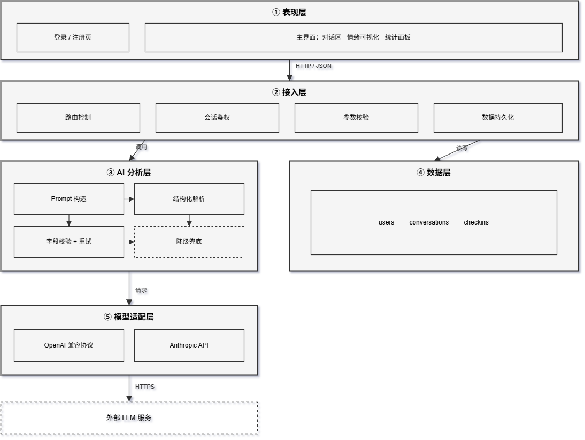

# 情绪星球 · AI 情绪支持 Agent

面向所有有情绪表达和陪伴需求的用户的 AI 对话应用，不限定特定人群。用户用自然语言描述当下发生的事，系统完成情绪识别、共情回应、行动建议与长期记录，并在检测到自伤风险时切换到安全流程。

> 一个可本地部署、重视隐私与使用体验的情绪支持项目。当前版本为可运行的原型，AI 能力边界与已知局限在文末明确列出。

---

## 目录

- [核心功能](#核心功能)
- [技术架构](#技术架构)
- [技术栈](#技术栈)
- [快速开始](#快速开始)
- [配置说明](#配置说明)
- [接口一览](#接口一览)
- [目录结构](#目录结构)
- [AI 技术设计](#ai-技术设计)
- [安全与边界](#安全与边界)
- [已知局限](#已知局限)
- [路线图](#路线图)
- [项目团队](#项目团队)

---

## 核心功能

**多轮对话与长期记忆**
每次记录绑定到话题（conversation），同一话题内的历史记录会作为上下文参与下一次分析，最近 8 条连同用户反馈一并送入模型。不同话题之间严格隔离，不串上下文。

**结构化情绪识别**
模型不直接输出一段文字，而是输出固定字段的 JSON：情绪类别（6 类）、强度（1–5）、置信度（0–1）、客观摘要、回应、建议、触发因素、追问、风险等级。前端按字段分别渲染，情绪类别驱动界面配色。

**语音输入**
聊天框支持类似微信的「按住说话」：按下按钮开始录音，松开或移出按钮结束并识别。默认走**本地离线模型** SenseVoice-Small（FunASR），音频不出本机、不经过任何在线语音服务。前端用 `MediaRecorder` 采集，在浏览器里直接转成 16kHz 单声道 WAV 再上传，因此不需要在本机另装 ffmpeg。识别结果填入输入框后仍可修改再发送，并会附带模型判断的语种与情绪（如「中文 · 中性」）。

本地模型不可用时（依赖装不上、权重加载失败、`ASR_MODE=off`）会自动退回浏览器 Web Speech API；两者都不可用则保持文字输入。**在线兜底是否可用取决于浏览器厂商的语音服务**，出现 `network` 错误时换网络或直接用文字即可。

**反馈闭环**
每条 AI 回应下方可标注「有帮助 / 不适合我」，反馈落库后参与后续对话上下文，并计入「建议被采纳率」统计。

**阶段回顾**
累计记录达到 3 条后，可基于统计结果生成阶段性回顾：趋势解释、模式归纳、下一步建议。样本不足时模型被要求明确说明局限性。

**危机识别**
关键词规则先行拦截（自伤、轻生表述），命中即提升风险等级并返回固定的安全建议（联系监护人、学校心理支持人员、110/120），不交由模型自由生成。

---

## 技术架构



五层结构自上而下：**表现层**负责对话与可视化，**接入层**承担路由、鉴权、参数校验与持久化，**AI 分析层**完成 Prompt 构造、结构化解析、字段校验与降级兜底，**数据层**以 SQLite 保存账号、话题与情绪记录，**模型适配层**屏蔽不同服务商的接口差异。

**语音支路**独立于这五层：表现层采集麦克风并在浏览器内转成 16kHz WAV，接入层校验后交给本机的 `sensevoice_asr.py` 推理，文字回到输入框再走正常对话链路。全程不经过任何外部服务。架构图绘制于语音模块接入之前，语音链路的完整说明见 [本地语音识别](#本地语音识别的工程取舍)。

实线表示主调用链与数据流，虚线表示降级路径与外部依赖。

各层职责（语音作为独立支路单列）：

| 层 | 文件 | 职责 |
|---|---|---|
| 接入层 | `app.py` | 路由、会话鉴权、参数校验、数据持久化、语音上传校验、依赖自检 |
| 分析层 | `ai_coach.py` | Prompt 构造、结构化输出解析、字段校验、重试、降级 |
| 模型层 | `llm_client.py` | 多服务商适配（OpenAI 兼容 / Anthropic）、超时与错误归一化 |
| 展示层 | `emotion-planet.html` | 对话渲染、情绪可视化、统计图表、录音与浏览器端转码 |
| 数据层 | `emotion_planet.db` | SQLite：账号、话题、情绪记录、反馈与 AI 配置 |
| 语音层 | `sensevoice_asr.py` | SenseVoice-Small 离线推理：语音转文字，附带语种 / 情绪 / 事件标签 |

设计上刻意让「分析层」与「模型层」分离：换模型只需改配置，不动业务逻辑；未配置模型时整条链路自动降级为关键词模式，界面明确标注「本地演示 · 非 AI」，不伪装成模型结果。

---

## 技术栈

| 类别 | 选型 | 说明 |
|---|---|---|
| 后端 | Python 3.10+ + Flask 3.x | 轻量，单进程即可运行；已在 3.14 上验证 |
| 数据库 | SQLite | 零配置，便于本地部署与数据管理 |
| 前端 | 原生 HTML / CSS / JavaScript | **零第三方依赖**，无 CDN、无构建步骤，首屏无网络等待 |
| 语音输入 | SenseVoice-Small（本地）/ Web Speech API（兜底） | 主路径为本地离线推理，音频不出本机；本地不可用时退回浏览器在线识别 |
| 语音推理 | FunASR + PyTorch（CPU） | 启动时自检，缺依赖自动补装；不需要 GPU，也不需要 ffmpeg |
| 模型接入 | OpenAI 兼容协议 / Anthropic | 可切换 DeepSeek、通义、Ollama 等 |
| 密码存储 | Werkzeug `generate_password_hash` | 加盐哈希，不存明文 |

前端不引入框架是有意为之：页面结构简单，引入 React/Vue 会带来构建链与包体积成本，而本项目更看重下载后即可运行、部署步骤清晰。

---

## 快速开始

### 环境要求

- Python 3.10 及以上
- 最新版 Chrome 或 Edge，以及可用麦克风；首次录音时在浏览器弹窗中允许麦克风权限
- 录音要求页面运行在 `localhost` / `127.0.0.1` 或 HTTPS 环境，无需安装浏览器拓展
- **必装：Flask 3.x**（Web 框架，不装会报 `No module named 'flask'`）
- 自动补装（无需手动）：`funasr` / `torch` / `torchaudio`，启动时自检，缺了在后台 `pip install`
- 本地语音另需模型权重（约 900MB）：首次识别自动下载，或用 `pack_model.py` 随包分发
- 可选：`anthropic`，只有使用 Claude 时才需要
- 无需 Node.js、无需 ffmpeg、无需单独安装数据库

### 依赖清单

| 依赖 | 是否需要装 | 用途 |
|---|---|---|
| `flask>=3.0` | 必须手动装 | 启动 Web 服务、提供 API 和页面 |
| `funasr` + `torch` + `torchaudio` | 自动 | 本地语音识别（SenseVoice-Small）。启动时自检补装；装不上则语音自动退回浏览器在线识别，其余功能不受影响 |
| `anthropic` | 否 | 仅在 `provider=anthropic` 时使用；DeepSeek、通义、Ollama 等不需要 |

`requirements.txt` 里只写必装依赖，语音依赖故意不列进去——它由 `app.py` 在启动时按需安装，避免 `pip install -r` 一次性拉几百 MB 让人以为项目很重。

```text
flask>=3.0
```

### 命令行安装

```bash
git clone https://github.com/Samjuice39/AI_Conversation.git
cd AI_Conversation

python -m venv .venv
# Windows
.venv\Scripts\activate
# macOS / Linux
source .venv/bin/activate

python -m pip install -r requirements.txt
```

安装后确认 Flask 在当前解释器里：

```bash
python -c "import flask; print(flask.__version__)"
```

能打印版本号（例如 `3.1.3`）才算装对。

### 用 IDEA / PyCharm 打开

IDEA 最容易出问题的不是没装 Flask，而是 **Run 用的解释器不是装了 Flask 的那个**。按下面顺序设置：

1. 打开项目目录 `AI_Conversation`。
2. `File → Settings → Project → Python Interpreter`。
3. 点 `Add Interpreter → Add Local Interpreter → Virtualenv Environment → New`。
4. Base interpreter 选 Python 3.10 或以上，位置保持项目下的 `.venv`，确定。
5. 打开 IDE 底部 `Terminal`，执行：

```bash
python -m pip install -r requirements.txt
python -c "import flask; print(flask.__version__)"
```

6. 打开 `app.py`，右键 `Run 'app'`。如果右上角 Run Configuration 里选的不是 `.venv\Scripts\python.exe`，改成它。

### 运行

```bash
python app.py
```

浏览器打开 <http://127.0.0.1:5001>，首次使用需注册账号（本地库，不联网）。

首次按住「按住说话」时，浏览器会请求麦克风权限，请选择「允许」。如果之前误点了拒绝，可在地址栏左侧的网站设置中将麦克风改为允许，再刷新页面。浏览器只负责录音，不需要拓展；SenseVoice 依赖和模型只用于把录音转成文字。

首次启动如果缺本地语音依赖，终端会打印安装进度，网页此时可以先正常用文字；装好后刷新页面即可用本地识别。

未配置模型时系统以本地规则模式运行，界面会明确标注，功能不受影响。

点击聊天框右上角的 **「AI 设置」**，每个登录账号都可以填写自己的 API 地址、模型名称和 API Key。网页对话只使用当前账号在「AI 设置」中保存的配置，不读取任何全局密钥。不填写或清除配置时使用本地规则模型；接口超时、密钥失效或返回格式错误也会自动回退，不会中断对话。

以 DeepSeek 为例：

| 设置项 | 填写内容 |
|---|---|
| API 地址 | `https://api.deepseek.com/v1` |
| 模型名称 | `deepseek-chat` |
| API Key | 测试者自己申请的密钥 |

密钥仅保存在运行程序的这台电脑的 SQLite 数据库中，不会回显到网页，也不会提交到 Git。本地版本不适合直接作为多用户公网服务部署。

### 常见错误

**`ModuleNotFoundError: No module named 'flask'`**

当前运行 `app.py` 的 Python 没装 Flask。不要只关掉报错，按下面任一方式处理：

```bash
# 方式一：在 IDEA 的 Terminal 里，用当前解释器安装
python -m pip install flask

# 方式二：确认虚拟环境已激活，再装依赖
.venv\Scripts\activate
python -m pip install -r requirements.txt
```

如果 `pip install flask` 后仍然报错，说明安装到了另一个 Python。检查 IDEA 的 `Python Interpreter` 和 Run Configuration，确保都指向 `.venv\Scripts\python.exe`。

---

## 配置说明

只需要在网页里配置，不再需要复制或编辑任何模板文件。

登录后打开聊天框右上角的「AI 设置」，每个账号独立保存自己的配置。支持 OpenAI 兼容的 `/chat/completions` 接口，例如 DeepSeek、通义千问、Kimi 和本地 Ollama；API 地址不带末尾的 `/chat/completions`，程序会自动补上。已保存密钥时，密钥输入框留空表示不修改；点击「清除 API，使用规则模型」会删除该账号的配置。

### 本地语音识别

默认启用，不需要任何配置。`python app.py` 启动时会自检 `torch` / `torchaudio` / `funasr`，缺哪个就在后台用**当前解释器**执行 `pip install` 补上——不阻塞网页启动，装好之后前端语音会自动从在线切回本地。装不上也不影响文字对话（语音退回浏览器在线识别），失败原因会写进 `/api/asr/status` 的 `deps.message`。

`flask` 是唯一需要手动装的依赖，其余都可以自动补。

可用环境变量调整：

| 变量 | 默认 | 说明 |
|---|---|---|
| `ASR_MODE` | `local` | 设为 `off` 关闭本地识别，语音退回浏览器在线识别 |
| `ASR_AUTO_INSTALL` | `1` | 设为 `0` 关闭自动安装（离线机器、内网环境建议关掉） |
| `ASR_DEVICE` | `cpu` | 有 CUDA 时可设为 `cuda:0` |
| `ASR_MAX_BYTES` | `20971520` | 单次上传上限（字节），对应约 10 分钟 16kHz WAV |

自动安装的判断依据是包能否 `import`，安装进度和失败原因通过 `GET /api/asr/status` 的 `deps` 字段暴露（`state` 依次可能是 `present` / `installing` / `installed` / `failed` / `disabled`）。

启动后可用 `GET /api/asr/status` 查看模型是否就绪（`available` / `cached` / `loaded`）。

识别接口为 `POST /api/asr`，需登录：表单字段 `audio`（16kHz 单声道 WAV）+ `language`（`auto` 或 `zh`/`en`/`yue`/`ja`/`ko`），返回 `text`、`languageText`、`emotionText`、`eventsText`、`elapsed`。测试：

```bash
python sensevoice_asr.py samples/asr_example_zh.wav
```

### 把项目发给别人时，模型带不带

模型权重默认在 `~/.cache/modelscope`（约 900MB），**不在项目里**。所以直接发代码，对方拿到的是 1.8MB 的轻量版本。

| 方式 | 体积 | 对方体验 |
|---|---|---|
| 只发代码 | 1.8MB | 语音自动走浏览器在线识别；若对方装了 `funasr`，首次识别会自动下载约 900MB 权重后转本地 |
| 代码 + `models/` | 约 900MB | 装好依赖后开箱即用，完全离线、不联网 |

要带上模型，在本机执行一次：

```bash
python pack_model.py
```

它把本机缓存里的 SenseVoiceSmall 和 VAD 复制到 `models/`，之后程序自动优先用这份权重（`/api/asr/status` 的 `source` 会从 `cache` 变成 `bundled`）。`models/` 已在 `.gitignore` 中，不会进 Git；用网盘或 U 盘随发布包一起给即可。

对方拿到后只需要装一个 `flask`，其余启动时自动补：

```bash
python -m pip install flask
python app.py
```

启动时会后台自检并安装 `torch` / `torchaudio` / `funasr`（首次约几分钟，期间网页可以正常用文字对话，装好后语音自动切回本地）。不用装 ffmpeg —— 录音已在浏览器端转成 16kHz WAV。

---

## 接口一览

除注册和登录外，所有接口都要求已登录（基于 Flask session），未登录返回 401。

| 方法 | 路径 | 说明 |
|---|---|---|
| POST | `/api/auth/register` · `/api/auth/login` · `/api/auth/logout` | 注册 / 登录 / 退出 |
| GET | `/api/auth/me` | 当前账号与称呼 |
| DELETE | `/api/auth/account` | 注销账号，需验证密码 |
| POST | `/api/chat` | 对话主接口：入参文本 / 情境 / 人设，返回结构化情绪结果 |
| GET · POST | `/api/conversations` | 话题列表 / 新建话题 |
| GET | `/api/conversations/<id>/messages` | 话题内全部记录 |
| DELETE | `/api/conversations/<id>` | 删除话题及其记录 |
| POST | `/api/checkins/<id>/feedback` | 标记回应是否有帮助 |
| GET | `/api/history` | 最近记录，`limit` 默认 30、上限 100 |
| GET | `/api/insights` | 统计：分布、近 7 天趋势、采纳率 |
| POST | `/api/insights/ai` | 阶段回顾，需至少 3 条记录 |
| GET · PUT · DELETE | `/api/ai/settings` | 各账号独立的大模型配置 |
| GET | `/api/ai/status` | 当前使用的模型来源 |
| GET | `/api/asr/status` | 本地语音状态：依赖、权重来源、是否已加载 |
| POST | `/api/asr` | 语音识别：表单 `audio`（16kHz WAV）+ `language` |

---

## 目录结构

```
.
├── app.py                    Flask 主服务：路由、鉴权、持久化
├── ai_coach.py               AI 分析层：Prompt、结构化解析、校验重试、降级、RAG 注入
├── rag_retriever.py          检索层：BM25F + 字符 bigram，纯标准库
├── agent_workflow.py         Agent 取数层：3 个工具的 Function Calling 编排
├── user_profile.py           偏好学习：从反馈统计表达偏好，不推断人格
├── knowledge/
│   └── interventions.json    干预策略知识库（40 条，6 类情绪）
├── docs/                     架构图（drawio 源文件 + 导出的 PNG）
├── llm_client.py             模型客户端：多服务商适配
├── sensevoice_asr.py         本地语音识别：SenseVoice-Small 离线推理（可选依赖）
├── pack_model.py             导出模型权重到 models/，便于随项目分发
├── models/                   模型权重（可选，由 pack_model.py 生成，不进 Git）
├── samples/
│   └── asr_example_zh.wav    语音识别自测样例（16kHz 单声道）
├── emotion-planet.html       主界面：对话 + 情绪可视化 + 统计
├── login.html                登录/注册页
├── requirements.txt          依赖清单
└── emotion_planet.db         SQLite 数据库（运行时生成，已 gitignore）
```

---

## AI 技术设计

### 为什么要求模型输出 JSON

自由文本无法稳定驱动界面。情绪类别要控制配色、强度要控制视觉权重、风险等级要触发不同的展示逻辑——这些都需要结构化字段。因此 Prompt 中固定了字段表，并要求「只输出一个完整合法 JSON」。

### 三层保障，避免「模型一抽风整页崩」

1. **JSON 提取容错**：模型偶尔包 ` ```json ` 围栏或加前后缀，解析器先剥离围栏，再用正则提取最外层花括号。
2. **字段校验**：逐字段检查取值范围（情绪码 0–5、强度 1–5、置信度 0–1、风险等级枚举），越界即视为失败。
3. **重试一次**：首次校验失败时，追加一句「上次输出不是合法 JSON，这次必须检查引号、逗号和括号」，再请求一次。两次都失败则降级到关键词模式，并保留 `source=fallback` 标记。

界面依据 `source` 字段显示「大模型主判定」或「本地演示 · 非 AI」，用户始终知道当前结果从哪来。

### Prompt 设计

风格约束不用「温柔、共情、专业」这类形容词，而是**给正例 + 给反例**：

- 明确禁止的套话：「我理解」「听起来」「这很正常」「你愿意吗」，以及表情符号
- 明确禁止的结构：固定「共情 + 建议 + 提问」三段式
- 给出 6 组情境示例（倾诉、开心、紧张、失望、烦躁、疲惫），每组包含输入与理想回应
- 允许留空：没有合适建议时 `suggestion` 为空，没有值得追问时 `followUpQuestion` 为空

这样做的原因是：形容词对模型几乎没有约束力，而示例和禁令是可检验的。

### 检索增强（RAG）

模型自身的建议容易停留在「深呼吸、找人聊聊」这类通用层面。系统在生成前先从干预策略知识库检索相关做法，作为参考素材注入 prompt，让建议落到具体步骤上。

**知识库**：`knowledge/interventions.json`，40 条策略，覆盖 6 类情绪（焦虑 12 / 烦躁 11 / 疲惫 10 / 低落 13 / 愉悦 4 / 平静 5，可多情绪共用）。每条包含适用情境、具体做法、何时适用和依据，来源是 CBT 认知重构、正念身体扫描、睡眠卫生、行为激活等有循证支持的常用技术。

**检索**：`rag_retriever.py`，BM25F + 字符 bigram，纯标准库实现。

选型理由：中文没有天然空格，按词切分需要引入分词器；字符 bigram 在短文本上召回接近分词效果且不需要词典。知识库只有几十条，向量检索的优势不明显，反而要连带 2 GB 的模型依赖——**评委下载后 `pip install -r requirements.txt` 就能跑，是这个项目更看重的**。

三个工程细节：

1. **字段加权**：标题权重 3.0、适用情境 2.5、何时适用 1.5、正文 1.0。不加权时，查询「旁边一直有人说话特别烦」会召回「给一个人发条消息」，因为两者共享「有人说话」这个字面片段；加权后情境词（烦躁 / 被打扰）才压得住。
2. **情绪码查询扩展**：用户原话未必带情绪词（「旁边一直有人说话特别烦」只出现一个「烦」）。检索前先用关键词粗判情绪码，补上该情绪的典型说法再匹配；同情绪策略 ×1.2，异情绪 ×0.45。
3. **只作参考，不照搬**：system prompt 明确要求「只在对方明确需要做法时自然融入一条，不要逐条列举、不要照搬措辞、不要为了用上而硬塞」。检索失败不阻断主流程——RAG 是增强项，不是必需项。

实测效果（模型为 `cn:hy3`）：用户明确询问「明天要上台做小组展示，特别紧张，总怕忘词，有什么办法缓解吗？」，检索召回「4-7-8 呼吸法」「担忧时间」「担忧分流」等条目，模型只把「4-7-8 呼吸法」融进回应，没有把多条策略列成清单。用户只是表达紧张、没有求助时，系统不会主动塞干预步骤。

### Agent 工作流与工具调用

模型不知道用户上周因为什么烦躁、也不知道上次给的建议有没有被采纳。要让回应贴合具体处境，它得先能取数。

系统用 Function Calling 让模型自己决定查什么：

| 工具 | 用途 | 触发条件（写在工具描述里） |
|---|---|---|
| `query_recent_records` | 查最近几天的情绪记录明细 | 用户提到「最近总是」「又」「一直」这类重复性表述 |
| `get_emotion_summary` | 情绪分布、平均强度、高频触发因素、采纳率 | 用户问「我最近怎么样」「有没有好转」 |
| `search_interventions` | 检索干预策略 | 用户需要可执行做法 |

**关键设计：取数与生成拆成两步。**

第一版让同一个模型「一边调工具一边写回应」，结果它把工具返回的操作步骤当成待办清单复述出来，情感回应被挤掉，输出变成「先停下…立刻做 15 分钟」。风格要求写了也没用——工具结果的权重压过了 prompt 里的风格约束。

改成两段：

1. `agent_workflow.collect()`：只判断「要不要查、查什么」，执行工具，把结果作为 `facts` 返回。这一步不生成任何用户可见文字。
2. `ai_coach.analyze(context, facts)`：拿 `facts` 走原来的单轮流程，那里有完整的风格示例和禁用词约束。

代价是多一次模型调用；收益是 Agent 的按需取数和单轮的表达质量都保住了。

实测（输入「旁边一直有人说话，我已经忍很久了，现在特别烦。」）：

```
轨迹：query_recent_records → search_interventions → 无需更多信息
回应：旁边一直有人说话，想安静做点事都难，忍到这会儿才烦，说明你前面已经压了挺久。
     他们可能只是没意识到声音会传那么远，不过这不影响你被打断的难受，
     你这边是实实在在被吵到了。
建议：空
追问：他们是一直在聊，还是断断续续那种？
```

**这里做过一次用户反馈修正。** 初版回应在共情之后接了两套应对方案，还加了「先别跟声音较劲」，读起来像在教用户做事。问题不在措辞，而在分支判断：用户只是发泄，并没有问「怎么办」。

现在的规则是：

- 倾诉、抱怨、描述处境：只回应感受和具体难处，`suggestion` 留空，回应里不出现「先…」「别…」「应该…」「试着…」这类指挥句。
- 倾诉收尾：用 `followUpQuestion` 把选择权交回去——「想一起想想怎么处理，还是先陪你发泄一下」。不替用户决定。
- 用户已经说「只想说说」：不再问要不要办法，改成「想从哪件说起」这类顺着话题的邀请。
- 明确问「怎么办」「有什么办法」：只给一个做法，用商量语气，不连续给两套备选方案，也不再追问要不要解决。
- 不用「你已经很坚强」「已经很能扛了」「这不是矫情」这类评价式安慰替代理解。夸得越用力，越像站在外面看。

这条规则同时写进了 system prompt、风格指南和示例。示例的影响最大——模型会模仿示例的结构，只在提示词里写「不要说教」压不住。

### 人设选择与自定义称呼

用户在聊天框上方选择人设，`persona` 随 `/api/chat` 一起提交，默认 `gentle`。

| 人设 | 默认行为 | 什么时候给建议 | 结尾追问 |
|---|---|---|---|
| 温柔陪伴 `gentle` | 先接住具体处境，默认只陪 | 只有明确问「怎么办」才给一个 | 想一起想办法，还是先发泄/待一会儿 |
| 酷酷解决 `cool` | 先判断问题核心，再给一个可执行动作 | 用户选择该人设即视为授权，可主动给一个方案 | 先拆哪一块，或是否继续深入 |
| 自定义 `custom` | 按用户填写的风格和态度回应 | 按自定义风格；安全规则优先 | 按自定义风格，一次只问一个 |

关键取舍：**酷酷解决型可以主动给建议，是因为用户显式选择了「解决问题」模式**，不是系统擅自判断。温柔陪伴型仍然保持默认不主动建议，避免回到「教用户做事」的老问题。

自定义人设不是无限制的：用户填写的风格会进入 system prompt，但“不诊断、不编造、不命令、不替用户做决定、危机优先”这些底线不能覆盖。自定义内容限制 120 字，空值回退到“自然、温和、尊重用户”。

称呼支持两种来源：

- 用户在输入框里填写“希望 AI 怎么称呼你”，保存在 `users.preferred_name`，之后自动沿用。
- 用户没有填写时，从对话中识别明确称呼，例如“宝宝，我今天……”或“叫我小明”，保存后用于后续回应。只识别称呼位置和常见昵称，不会把“我家宝宝今天……”误判成在叫 AI。

两套人设共同的表达约束：

- **先站队，再补充视角。** 温柔陪伴型先肯定用户的感受和处境；涉及他人时，最多用一两句轻轻补充「对方可能是怎么想的」，必须用“可能/也许”限定，不能替对方开脱，说完马上回到用户这一边。超过两句就删掉，否则会显得偏向外人。
- **提问也是陪伴。** 想了解事情整体时，可以问一个具体细节（当时发生了什么、对方说了什么、你当时怎么应对），让用户继续说下去；一次只问一个，不审问。追问只放在 `followUpQuestion`，`response` 末尾不重复同一个问题。
- **方法不能是万能模板。** 酷酷解决型信息不足时，先问一个最能决定方案的关键细节，再给做法；不要拿通用建议硬套，也不要把问题归因于用户“忍得不够久”。

两套人设共享同一条安全底线：不诊断、不编造经历、不替用户做决定、危机场景优先本地规则。区别只在表达顺序、建议密度和追问方式。

前端选择会写入 `localStorage`，刷新页面后保留。每条聊天记录也会保存本次使用的 `persona`，用于后续偏好统计。

### 从反馈里学习表达偏好

个性化不是让模型自称「懂你」，而是让下一次回应根据真实反馈调整。

- 所有 AI 回复都提供「这条回应有帮助 / 不太适合我」，不再只限于带建议的回复。
- `user_profile.py` 统计最近 60 条已反馈记录，提取五类可解释偏好：
  - 有帮助 / 没帮助回复的平均长度 → 偏简短还是偏展开
  - 有建议 / 没建议的满意率 → 建议密度
  - 有追问 / 没追问的满意率 → 是否愿意被追问
  - 温柔陪伴 / 酷酷解决的满意率 → 仅作提示，不自动替用户切换
  - 每段对话前两条与后两条的情绪对比 → 负面情绪是否趋于平稳
- 情绪轨迹只认“开头有负面、结尾负面减少或强度明显下降”的对话，不把单纯时间流逝当成功；它作为“这种回应节奏值得延续”的弱证据，不宣称因果。
- 少于 3 条反馈不做人设偏好结论；建议/追问偏好至少两类各 1 条才比较。没有形成明确偏好时不注入、也不显示“已调整”。
- 偏好以「用户偏好」字段进入 Prompt，只调整语气、长度、建议密度和追问方式；不诊断、不向用户提及画像、不覆盖当前人设。
- 新回复下方会显示「已根据 N 次反馈 / 近期对话变化调整：…」，让用户知道系统为什么变化，而不是偷偷改变。

这是行为统计，不是人格画像。数据只存在本地 SQLite，不额外上传。

**工程细节**：

- 工具描述里写清楚「什么时候该用」，比在 system prompt 里写规则更有效——模型对工具描述的关注度更高。
- `max_steps=2` 上限，防止模型反复查。
- 工具执行异常不中断对话，错误信息作为结果返回给模型，它会自己绕开。
- 取数失败自动退回纯单轮，用户无感知。
- 环境变量 `AGENT_MODE=0` 可关闭 Agent，用于对比两种模式。

### 本地语音识别的工程取舍

**为什么不直接用浏览器自带的 Web Speech API。** 它零成本，但识别发生在浏览器厂商的服务器上：国内网络经常直接报 `network` 错误，而且用户说的是一段情绪困扰，把音频送到第三方并不合适。本地模型才能让「音频不出本机」这句话真的成立。

**为什么选 SenseVoice-Small。** 它一个模型同时给出文字、语种（中英粤日韩）、情绪（7 类）和音频事件（笑声 / 哭声 / 掌声等），正好贴合情绪陪伴场景——识别到的情绪可以与对话工作流里的判断互相印证。体积约 900MB，CPU 上 5.5 秒音频约 0.2 秒出结果，普通笔记本不用显卡也能运行。代价是它更适合短语音，长录音要靠 VAD 切片。

**为什么让浏览器转 WAV。** `MediaRecorder` 录出来是 webm/opus，本机没装 ffmpeg 时 torchaudio 读不了；要求用户装 ffmpeg 又破坏了「下载即运行」。所以在前端用 `decodeAudioData` 解出 PCM，降混单声道、线性重采样到 16kHz、手写 44 字节 WAV 头再上传。实测产出标准 `16000Hz / 1ch / 16bit`，后端按最普通的方式读取即可。

完整链路：

```text
按住「按住说话」，松开或移出按钮结束
  → getUserMedia 采集麦克风
  → MediaRecorder 录制（webm/opus，最长 60 秒）
  → decodeAudioData 解码 → 降混单声道 → 重采样 16kHz → 编码 WAV
  → POST /api/asr（临时文件，识别后立即删除）
  → SenseVoice-Small 本机推理
  → 文本 + 语种 + 情绪回填输入框，可修改后再发送
```

**三级降级，每一级都留痕迹。** 本地识别失败 → 浏览器在线识别 → 文字输入。前端在页面加载时先探测 `/api/asr/status`，不可用就直接绑在线识别，不会让用户先录一遍再报错；`source` 字段区分权重来自项目内（`bundled`）、本机缓存（`cache`）还是需要联网下载（`download`）。

**依赖自己装，但不偷偷装。** 启动时用 `importlib.util.find_spec` 查 `torch` / `torchaudio` / `funasr`，缺了才在后台线程用 `sys.executable -m pip install` 补装，网页照常可用。装失败只把原因写进 `deps.message`，语音退回在线，不阻塞任何功能。这段逻辑做成幂等的模块级调用，`python app.py`、`flask run`、gunicorn 都能触发；`ASR_AUTO_INSTALL=0` 可整体关闭。

### 降级策略

| 场景 | 行为 |
|---|---|
| 未配置模型 | 关键词分类，界面标注「本地演示 · 非 AI」，置信度固定 0.3 |
| 模型超时 / 网络错误 | 同上，并在服务端日志记录原因 |
| 连续两次输出非法 JSON | 同上 |
| 命中危机关键词 | 强制 `riskLevel=high`，返回固定安全建议，不依赖模型 |
| 知识库缺失 / 检索异常 | 跳过检索，prompt 中不带参考素材，主流程不受影响 |
| 本地语音依赖缺失 | 后台自动 `pip install`；安装期间语音走浏览器在线识别 |
| 自动安装失败 / 无外网 | 语音退回浏览器在线识别，原因写入 `deps.message` |
| 本地识别报错或超时 | 前端提示后改用浏览器在线识别，也可直接文字输入 |
| 浏览器不支持录音 | 退回 Web Speech API；它也不可用则只保留文字输入 |

---

## 安全与边界

- **不做诊断**：Prompt 明确禁止输出医学结论，界面文案统一为「基于你主动描述的对话式理解」。
- **不编造**：要求模型只能依据提供的对话历史肯定具体努力，不得编造共同经历。
- **危机优先**：自伤表述由本地规则拦截，优先于模型判断，避免模型「温和化」处理。
- **密码安全**：`werkzeug.security` 加盐哈希，数据库不存明文。
- **密钥隔离**：每个网页账号使用自己的 API 配置；密钥不回显、不写入前端存储，本地数据库不进入 Git。本地 SQLite 中的用户密钥未加密，不应把数据库文件发给别人。
- **语音不出本机**：默认识别在本机推理，音频转成临时文件后识别完立即删除，不落库、不上传任何第三方。
- **数据本地化**：默认 SQLite 本地存储，不向第三方上传对话记录（模型调用除外）。

---

## 已知局限

如实列出，不回避：

1. **Agent 能力有限**。工具调用只用于「取数」（查历史、查统计、检索策略），取回后仍由单轮调用生成回应；模型不能执行写操作，也不会多步规划复杂任务。
2. **检索用 BM25F，非向量检索**。基于字面匹配 + 字段加权 + 情绪码查询扩展，能覆盖几十条知识库的召回，但没有语义泛化能力——换个说法可能召不回同一条策略。
3. **语音识别分两级**。默认走本地 SenseVoice-Small：CPU 推理，首次识别要加载权重（约 10–13 秒），之后单次 60 秒内音频通常 1 秒内出结果；进程常驻内存约 1.4 GB，加载瞬间峰值约 2.2 GB（实测 5.5 秒样例识别耗时 0.22 秒）。首次启动的自动安装需要能访问 PyPI，装不上会自动退回浏览器 Web Speech API（需 Chrome/Edge + HTTPS/localhost）。单次录音上限 60 秒，长段连续说话需要分段；图像输入仍未接入。
4. **前端非 TypeScript**。原生 JS，无组件化与类型约束，可维护性有限。
5. **情绪判断依赖自我描述**。用户表达不准确时，识别结果会随之偏移；系统不做交叉验证。
6. **单机部署**。Flask 开发服务器，未做并发与生产级加固。

以上第 1–2 项为下一阶段的主要改造方向，见路线图。

---

## 路线图

| 阶段 | 目标 | 对应能力 |
|---|---|---|
| 已完成 | 多轮对话、结构化识别、反馈闭环、阶段回顾、危机兜底 | — |
| 已完成 | 干预策略知识库 + BM25F 检索 + prompt 增强 | RAG |
| 已完成 | 工具调用：历史查询、情绪统计、策略检索（3 个 Function） | Function Calling |
| 已完成 | 取数与生成分离的工作流：判断 → 工具 → 生成 | Agent |
| 已完成 | 双人设、自定义风格、称呼学习、反馈与情绪轨迹偏好 | 个性化 |
| 已完成 | 浏览器语音输入，支持权限与兼容性降级 | 多模态 |
| 已完成 | 本地离线语音识别 SenseVoice-Small 接入，带在线兜底 | 多模态 |
| 已完成 | 依赖自检与自动安装、模型权重随包分发 | 交付体验 |
| 计划 | 前端迁移 TypeScript + 组件化 | 工程质量 |

---

## 项目团队

| 项目 | 内容 |
|---|---|
| 项目成员 | 岑康元、胡宸溢、蔡妤丹 |
| 所在院校 | 广东石油化工学院 |
| 联系方式 | 15112341746 |
| 指导教师 | 梁松、林水泉 |

---

## 许可

项目源代码与文档供学习交流使用；使用第三方模型和依赖时，请遵循各自的许可条款。
