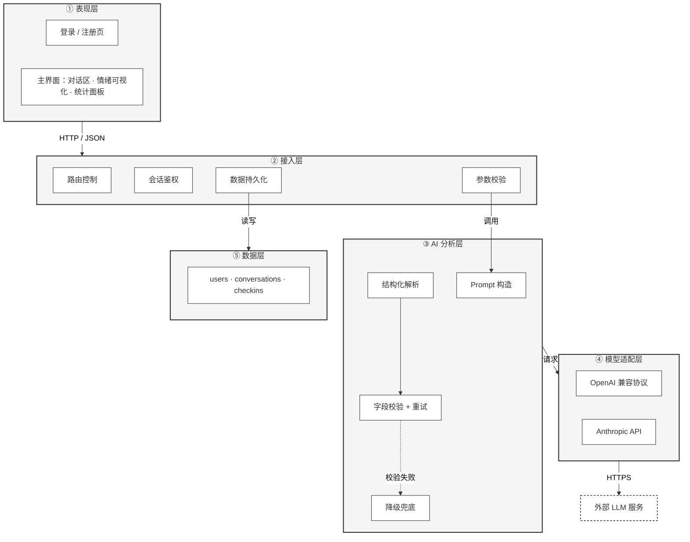

# 情绪星球 · AI 情绪支持 Agent

面向日常情绪管理的 AI 对话应用。用户用自然语言描述当下发生的事，系统完成情绪识别、共情回应、行动建议与长期记录，并在检测到自伤风险时切换到安全流程。

> 本项目为传智杯参赛作品。当前版本为可运行的原型，AI 能力边界与已知局限在文末明确列出。

---

## 目录

- [核心功能](#核心功能)
- [技术架构](#技术架构)
- [技术栈](#技术栈)
- [快速开始](#快速开始)
- [配置说明](#配置说明)
- [目录结构](#目录结构)
- [AI 技术设计](#ai-技术设计)
- [安全与边界](#安全与边界)
- [已知局限](#已知局限)
- [路线图](#路线图)
- [团队信息](#团队信息)

---

## 核心功能

**多轮对话与长期记忆**
每次记录绑定到话题（conversation），同一话题内的历史记录会作为上下文参与下一次分析，最近 8 条连同用户反馈一并送入模型。不同话题之间严格隔离，不串上下文。

**结构化情绪识别**
模型不直接输出一段文字，而是输出固定字段的 JSON：情绪类别（6 类）、强度（1–5）、置信度（0–1）、客观摘要、回应、建议、触发因素、追问、风险等级。前端按字段分别渲染，情绪类别驱动界面配色。

**反馈闭环**
每条 AI 回应下方可标注「有帮助 / 不适合我」，反馈落库后参与后续对话上下文，并计入「建议被采纳率」统计。

**阶段回顾**
累计记录达到 3 条后，可基于统计结果生成阶段性回顾：趋势解释、模式归纳、下一步建议。样本不足时模型被要求明确说明局限性。

**危机识别**
关键词规则先行拦截（自伤、轻生表述），命中即提升风险等级并返回固定的安全建议（联系监护人、学校心理支持人员、110/120），不交由模型自由生成。

---

## 技术架构



> 图中 ①–④ 为本项目实现的四层结构；⑤ 数据层与主调用链并列，由接入层直接读写。实线表示主调用链与数据流，虚线表示降级路径与外部依赖。
> 可编辑源文件见 [`docs/系统架构图.drawio`](docs/系统架构图.drawio)，用 draw.io 打开后可导出 300 dpi 的 PNG 或 SVG。

四层职责：

| 层 | 文件 | 职责 |
|---|---|---|
| 接入层 | `app.py` | 路由、会话鉴权、参数校验、数据持久化 |
| 分析层 | `ai_coach.py` | Prompt 构造、结构化输出解析、字段校验、重试、降级 |
| 模型层 | `llm_client.py` | 多服务商适配（OpenAI 兼容 / Anthropic）、超时与错误归一化 |
| 展示层 | `emotion-planet.html` | 对话渲染、情绪可视化、统计图表 |

设计上刻意让「分析层」与「模型层」分离：换模型只需改配置，不动业务逻辑；未配置模型时整条链路自动降级为关键词模式，界面明确标注「本地演示 · 非 AI」，不伪装成模型结果。

---

## 技术栈

| 类别 | 选型 | 说明 |
|---|---|---|
| 后端 | Python 3.13 + Flask 3.x | 轻量，单进程即可运行 |
| 数据库 | SQLite | 零配置，便于评审一键运行 |
| 前端 | 原生 HTML / CSS / JavaScript | **零第三方依赖**，无 CDN、无构建步骤，首屏无网络等待 |
| 模型接入 | OpenAI 兼容协议 / Anthropic | 可切换 DeepSeek、通义、Ollama 等 |
| 密码存储 | Werkzeug `generate_password_hash` | 加盐哈希，不存明文 |

前端不引入框架是有意为之：页面结构简单，引入 React/Vue 会带来构建链与包体积成本，而本项目更看重「评审下载即可运行」。

---

## 快速开始

### 环境要求

- Python 3.10 及以上
- 无需 Node.js、无需数据库服务

### 安装

```bash
git clone <仓库地址>
cd <项目目录>

python -m venv .venv
# Windows
.venv\Scripts\activate
# macOS / Linux
source .venv/bin/activate

pip install -r requirements.txt
```

### 运行

```bash
python app.py
```

浏览器打开 <http://127.0.0.1:5001>，首次使用需注册账号（本地库，不联网）。

未配置模型时系统以关键词模式运行，界面会明确标注，功能不受影响。

---

## 配置说明

模型配置支持两种方式，**环境变量优先于配置文件**。

### 方式一：环境变量（推荐，适合部署）

```bash
export EMOTION_LLM_PROVIDER=openai
export EMOTION_LLM_API_KEY=your-key-here
export EMOTION_LLM_MODEL=deepseek-chat
export EMOTION_LLM_BASE_URL=https://api.deepseek.com/v1
export EMOTION_LLM_TIMEOUT=60
export HOST=127.0.0.1
export PORT=5001
```

Windows PowerShell：

```powershell
$env:EMOTION_LLM_PROVIDER="openai"
$env:EMOTION_LLM_API_KEY="your-key-here"
```

### 方式二：配置文件（适合本地开发）

复制 `llm_config.example.json` 为 `llm_config.json`，填入自己的密钥。该文件已被 `.gitignore` 排除，**不会进入仓库**。

```json
{
  "provider": "openai",
  "apiKey": "your-key-here",
  "model": "deepseek-chat",
  "baseUrl": "https://api.deepseek.com/v1",
  "timeout": 60
}
```

### 支持的服务商

| provider | 说明 |
|---|---|
| `openai` | 任何兼容 `/v1/chat/completions` 的服务：DeepSeek、通义千问、Kimi、本地 Ollama 等 |
| `anthropic` | Claude 系列，需额外 `pip install anthropic` |
| `none` | 不接入模型，走关键词兜底 |

---

## 目录结构

```
.
├── app.py                    Flask 主服务：路由、鉴权、持久化
├── ai_coach.py               AI 分析层：Prompt、结构化解析、校验重试、降级
├── llm_client.py             模型客户端：多服务商适配
├── emotion-planet.html       主界面：对话 + 情绪可视化 + 统计
├── login.html                登录/注册页
├── llm_config.example.json   配置模板（不含真实密钥）
├── requirements.txt          依赖清单
└── emotion_planet.db         SQLite 数据库（运行时生成，已 gitignore）
```

---

## AI 技术设计

### 为什么要求模型输出 JSON

自由文本无法稳定驱动界面。情绪类别要控制配色、强度要控制视觉权重、风险等级要触发不同的展示逻辑——这些都需要结构化字段。因此 Prompt 中固定了字段表，并要求「只输出一个完整合法 JSON」。

### 三层保障，避免「模型一抽风整页崩」

1. **JSON 提取容错**：模型偶尔包 ` ```json ` 围栏或加前后缀，解析器先剥离围栏，再用正则提取最外层花括号。
2. **字段校验**：逐字段检查取值范围（情绪码 0–5、强度 1–5、置信度 0–1、风险等级枚举），越界即视为失败。
3. **重试一次**：首次校验失败时，追加一句「上次输出不是合法 JSON，这次必须检查引号、逗号和括号」，再请求一次。两次都失败则降级到关键词模式，并保留 `source=fallback` 标记。

界面依据 `source` 字段显示「大模型主判定」或「本地演示 · 非 AI」，用户始终知道当前结果从哪来。

### Prompt 设计

风格约束不用「温柔、共情、专业」这类形容词，而是**给正例 + 给反例**：

- 明确禁止的套话：「我理解」「听起来」「这很正常」「你愿意吗」，以及表情符号
- 明确禁止的结构：固定「共情 + 建议 + 提问」三段式
- 给出 6 组情境示例（倾诉、开心、紧张、失望、烦躁、疲惫），每组包含输入与理想回应
- 允许留空：没有合适建议时 `suggestion` 为空，没有值得追问时 `followUpQuestion` 为空

这样做的原因是：形容词对模型几乎没有约束力，而示例和禁令是可检验的。

### 降级策略

| 场景 | 行为 |
|---|---|
| 未配置模型 | 关键词分类，界面标注「本地演示 · 非 AI」，置信度固定 0.3 |
| 模型超时 / 网络错误 | 同上，并在服务端日志记录原因 |
| 连续两次输出非法 JSON | 同上 |
| 命中危机关键词 | 强制 `riskLevel=high`，返回固定安全建议，不依赖模型 |

---

## 安全与边界

- **不做诊断**：Prompt 明确禁止输出医学结论，界面文案统一为「基于你主动描述的对话式理解」。
- **不编造**：要求模型只能依据提供的对话历史肯定具体努力，不得编造共同经历。
- **危机优先**：自伤表述由本地规则拦截，优先于模型判断，避免模型「温和化」处理。
- **密码安全**：`werkzeug.security` 加盐哈希，数据库不存明文。
- **密钥隔离**：配置文件与 `.env` 均在 `.gitignore` 中，仓库只保留模板。
- **数据本地化**：默认 SQLite 本地存储，不向第三方上传对话记录（模型调用除外）。

---

## 已知局限

如实列出，不回避：

1. **非 Agent 架构**。当前为单轮「输入 → 分析 → 输出」调用，没有任务规划、工具调用与自主决策能力。
2. **无 RAG**。Prompt 中不含外部知识检索，建议质量依赖模型自身知识。
3. **仅文本模态**。未接入语音、图像输入。
4. **前端非 TypeScript**。原生 JS，无组件化与类型约束，可维护性有限。
5. **情绪判断依赖自我描述**。用户表达不准确时，识别结果会随之偏移；系统不做交叉验证。
6. **单机部署**。Flask 开发服务器，未做并发与生产级加固。

以上第 1–3 项为下一阶段的主要改造方向，见路线图。

---

## 路线图

| 阶段 | 目标 | 对应能力 |
|---|---|---|
| 已完成 | 多轮对话、结构化识别、反馈闭环、阶段回顾、危机兜底 | — |
| 下一步 | 检索增强：构建干预策略知识库，生成前召回相关策略 | RAG |
| 下一步 | 工具调用：历史查询、统计聚合、知识检索、随访安排 | Function Calling |
| 计划 | 工作流重构：识别 → 检索 → 规划 → 工具 → 生成 → 自检 | Agent |
| 计划 | 语音输入（Web Speech API），支持口述记录 | 多模态 |
| 计划 | 前端迁移 TypeScript + 组件化 | 工程质量 |

---

## 团队信息

| 项目 | 内容 |
|---|---|
| 参赛者 | [待填写] |
| 所在院校 | [待填写] |
| 联系方式 | [待填写] |
| 指导教师 | [待填写] |

---

## 许可

本项目仅用于赛事评审与学习交流。
